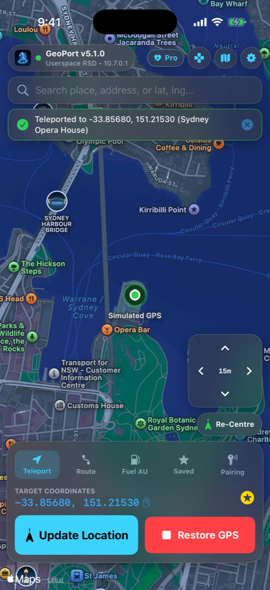
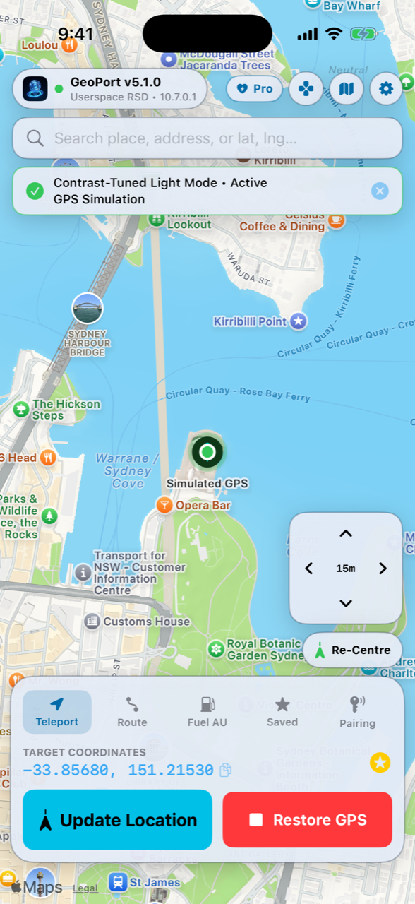
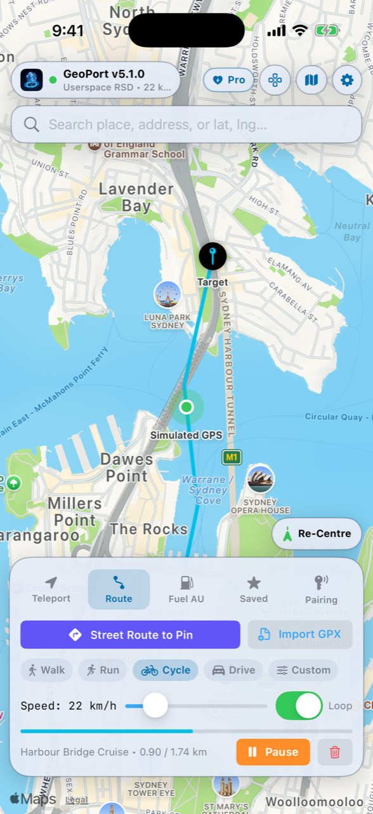
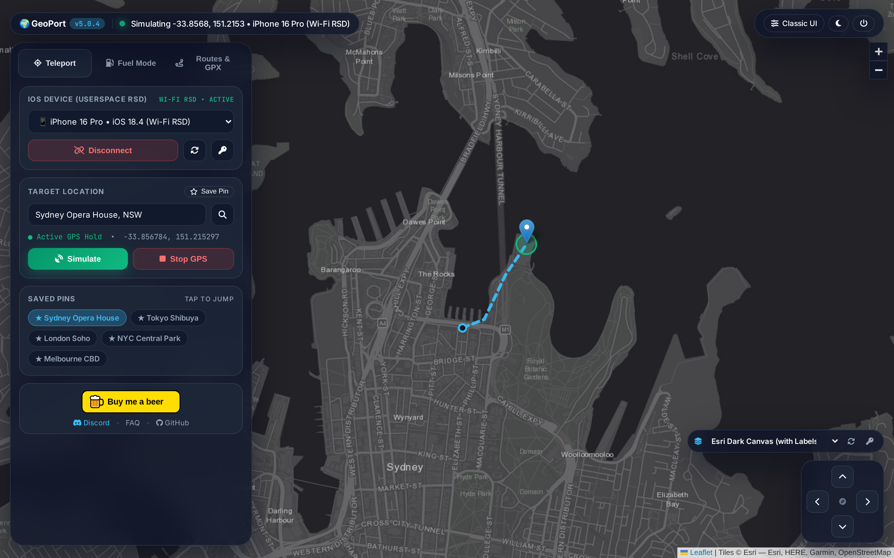
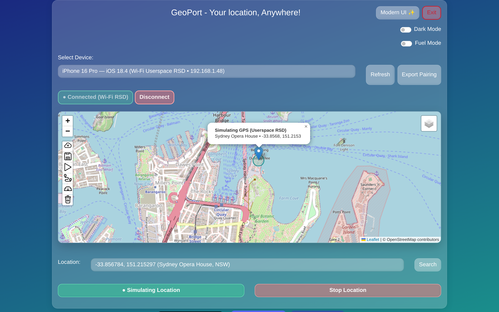
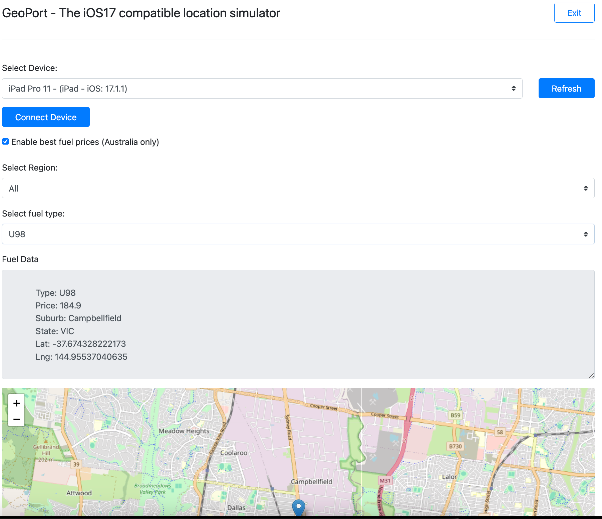
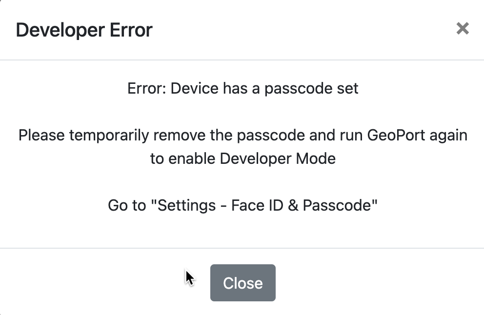

# GeoPort v5: Your iOS Location, Anywhere! 🌍

<p align="center">
  <a href="https://buymeacoffee.com/davesc63">
    
  </a>
  <br><br>
  <a href="https://geoport.me"><strong>https://geoport.me</strong></a> &nbsp;&bull;&nbsp;
  <a href="https://geoport.me/ios.html#waitlist"><strong>Untethered iOS Waitlist</strong></a> &nbsp;&bull;&nbsp;
  <a href="https://geoport.me/guide.html"><strong>Instruction Guide</strong></a>
</p>

<p align="center">
  <a href="https://github.com/davesc63/GeoPort/releases/latest">
    
  </a>
  <a href="https://geoport.me/ios.html#waitlist">
    
  </a>
  <a href="https://geoport.me/guide.html">
    
  </a>
  <a href="https://discord.gg/genRca55Nb">
    
  </a>
</p>

<p align="center">
  <strong>GeoPort is free and community-supported.</strong><br>
  If GeoPort saves you time or unlocks new workflows, please consider <a href="https://buymeacoffee.com/davesc63"><strong>buying me a beer</strong></a> to help keep development going across every new iOS release!
</p>

---

## 📱 NEW BREAKTHROUGH: GeoPort Untethered iOS App (`v5.1` Beta)

Run GeoPort **100% standalone directly on your iPhone** — no PC, Mac, or cable attached while spoofing! Built with a native **SwiftUI + Rust CoreDevice & Userspace RSD engine**, GeoPort iOS lets you teleport anywhere on Earth, nudge with the floating Compass D-pad, cruise street-routed GPX tracks, and hold simulated GPS with your screen locked using a **$0 Free Apple ID** via **SideStore & LocalDevVPN** (plus zero-PC on-device pairing ready for iOS 27+).

- 🚀 **[Register for the iOS Waitlist (`geoport.me/ios.html#waitlist`)](https://geoport.me/ios.html#waitlist)** — Controlled `v5.1` tester invite waves
- 📖 **[Full Instruction Guide (`geoport.me/guide.html`)](https://geoport.me/guide.html)** — 4-Step Setup, Daily Controls, 5G 3-Second Handshake & Settings Reference

<table align="center">
  <tr>
    <td align="center" width="33%">
      <a href="https://geoport.me/ios.html#waitlist">
        
      </a>
      <br><sub><strong>Dark Mode Spatial HUD</strong><br>3D Map, D-Pad &amp; 1-Tap Restore GPS</sub>
    </td>
    <td align="center" width="33%">
      <a href="https://geoport.me/guide.html">
        
      </a>
      <br><sub><strong>Contrast-Tuned Light Mode</strong><br>Crisp Slate-Mist Daylight Controls</sub>
    </td>
    <td align="center" width="33%">
      <a href="https://geoport.me/guide.html">
        
      </a>
      <br><sub><strong>Street Routes &amp; GPX Player</strong><br>Walk, Run, Cycle &amp; Drive Profiles</sub>
    </td>
  </tr>
</table>

---

## 🖥️ Cross-Platform Desktop Studio: Modern Spatial HUD & Classic UI

**GeoPort Desktop** is a cross-platform iOS GPS location simulation studio for **Windows**, **macOS (Apple Silicon & Intel)**, and **Ubuntu Linux / Headless Servers**. Teleport anywhere on Earth, nudge your position in real time with keyboard arrow keys or the on-screen D-pad, replay GPX/GeoJSON tracks, or cruise along real street-routed journeys over **Wi-Fi** or **USB** — with **zero jailbreak** and **zero `sudo` / Administrator elevation** required.

### ✨ Desktop Modern UI (`Spatial Location Studio` — Default)
Sleek dark glassmorphic command deck (`/?ui=modern`) with live Userspace RSD telemetry, saved pin chips, Fuel Watch, Route Builder, 21 dynamic map overlays, and a floating compass D-pad:

<p align="center">
  
</p>

### 🎛️ Desktop Classic UI (`1-Click Switchable`)
Prefer the original streamlined GeoPort workflow? Click **Classic UI** in the top bar (`/?ui=classic`) anytime to switch instantly with full GPX/Route drawing tools, Fuel Mode, and 1-click pairing export:

<p align="center">
  
</p>

---

## 🚀 What's New in GeoPort v5 — Pure Userspace Engine!

GeoPort v5 is a ground-up architectural upgrade built on the latest **`pymobiledevice3` (v11.61+)** and **`pmd-pytcp`** pure-userspace networking stack.

### Why GeoPort v5 is a Huge Leap Forward

| Capability | GeoPort v4 (Legacy) | GeoPort v5 (New!) | Benefit to You |
| :--- | :--- | :--- | :--- |
| **CoreDevice RSD Tunnel** | OS Kernel TUN (`utun` / `WinTun` / `/dev/net/tun`) | **100% Pure Userspace TCP/IPv6 RSD** | **No `sudo` password on macOS/Linux** and **no UAC Administrator prompt or `WinTun` driver on Windows!** |
| **iOS Compatibility** | iOS 17 – iOS 18 | **iOS 17, iOS 18 & iOS 26+** | Ready for Apple's newest iOS builds out of the box |
| **Wi-Fi Discovery** | Basic Bonjour lookup | **Cryptographic `_apple-mobdev2._tcp` Matching** | Reliably discovers paired iPhones over Wi-Fi even with iOS **Private Wi-Fi Address** MAC randomization enabled |
| **Linux & Home Servers** | Required root + `/dev/net/tun` + `usbmuxd` | **First-Class Rootless Linux & Headless LXC** | Run GeoPort 24/7 on an Ubuntu box, Raspberry Pi, or unprivileged Proxmox LXC over Wi-Fi and control it from any browser on your LAN |
| **Location Stability** | Re-opened DVT per update | **Persistent Sub-10ms Location Channel + Keep-Alive** | Instant arrow-key/route updates and rock-solid GPS hold that won't snap back to real GPS mid-session |
| **Developer Mode Setup** | Required removing passcode | **Passcode-Friendly UI Reveal** | Automatically reveals `Settings → Privacy & Security → Developer Mode` without forcing you to delete Face ID / Passcode |
| **Web Interface & Maps** | Classic View only | **New Spatial HUD + Classic UI (Zero API Keys)** | Sleek dark glassmorphic Spatial HUD (`/?ui=modern`) + 1-click Classic toggle (`/?ui=classic`) with locally cached OpenStreetMap, Dark, Topo & Satellite tiles |

---

## ✨ Key Features

- **🌍 Global Teleportation & Street Routing** — Double-click anywhere on the globe, search any address/landmark, or generate realistic multi-stop street routes with **Walk**, **Run**, **Cycle**, **Drive**, or custom `km/h` speed profiles.
- **🕹️ Live Keyboard & Touch D-Pad Control** — Nudge your live simulated GPS position smoothly using your keyboard arrow keys or the on-screen compass D-pad.
- **📂 GPX & GeoJSON Playback** — Drag-and-drop `.gpx` or `.geojson` tracks to simulate runs, rides, and drives with live progress and pause/resume controls.
- **📶 True Wireless Wi-Fi Workflow** — Pair once over USB, enable Wi-Fi connection, unplug the cable, and simulate wirelessly across your local network.
- **🎨 Dual Web UI (`Spatial HUD` & `Classic`)** — Launch into the dark glassmorphic Spatial Studio or click **Classic UI** anytime if you prefer the original GeoPort layout.

<p align="center">
  
</p>

---

## 🗺️ Map Overlays & Local Overrides (No Rebuild Required!)

GeoPort v5.0.2+ includes **21 curated map overlays** out of the box across both the **Spatial HUD** (`🗺️` selector above the D-pad) and **Classic UI** (top-right layer switcher):

- **13 Zero-API-Key Global Overlays** *(work everywhere — `localhost`, LAN IPs like `192.168.x.x`, and headless servers)*:
  - **Dark**: *Esri Dark Canvas (with Street & Place Labels)*, *OSM Midnight (Detailed Dark)*
  - **Streets & Terrain**: *Esri World Street Map*, *Esri World Topo Map*, *Esri Light Smooth Canvas*, *OpenStreetMap*, *OpenStreetMap HOT*, *OpenTopoMap (Contours)*
  - **Satellite & Specialty**: *Esri Satellite Hybrid (Imagery + Roads & Labels)*, *Esri World Imagery*, *Esri National Geographic*, *OPNVKarte (Transit & Airports)*, *CyclOSM (Trails & Bikeways)*
- **8 Classic Stadia Overlays** *(OSM Bright, Alidade Smooth, Alidade Smooth Dark, Outdoors, Stamen Terrain, Stamen Toner, Stamen Watercolor, Alidade Satellite)*:
  - Automatically active on `http://localhost` (Windows & macOS desktop).
  - Running GeoPort on a LAN IP / headless server and want Stadia there too? Click the **`🔑` key icon** next to the map selector (or set `stadia_api_key` below) to paste a free personal [Stadia Maps](https://stadiamaps.com/) API key.

### Live GitHub Sync & Custom Local Overrides

GeoPort automatically syncs new or updated map providers from [`MAP_LAYERS.json`](https://github.com/davesc63/GeoPort/blob/main/MAP_LAYERS.json) (or click the **`↻` sync icon** next to the map dropdown anytime) — so map URLs and styles stay fresh without needing a new app binary.

You can also add your own custom XYZ tile servers, set a personal API key, or change default startup layers locally — **applied immediately on browser refresh (`F5`) with no restart or repackaging**:

- **macOS / Linux**: `~/.geoport/map_layers.json` *(or `./MAP_LAYERS.json` in the working directory)*
- **Windows**: `%USERPROFILE%\.geoport\map_layers.json`

```json
{
  "stadia_api_key": "YOUR_OPTIONAL_FREE_STADIA_KEY",
  "defaults": {
    "modern_dark": "esri_dark_gray",
    "modern_light": "esri_world_topo",
    "classic": "esri_world_street"
  },
  "extra_layers": [
    {
      "id": "my_custom_tiles",
      "name": "My Custom XYZ Map",
      "category": "Custom",
      "url": "https://tile.openstreetmap.org/{z}/{x}/{y}.png",
      "maxZoom": 19,
      "attribution": "© OpenStreetMap contributors"
    }
  ]
}
```

> **Tip for UI Tinkerers:** GeoPort v5 also checks `~/.geoport/templates/` (and `./templates/` next to the binary) *before* bundled templates — drop a customized `map_modern.html` or `map.html` there and hit refresh (`F5`) to tweak the UI live without rebuilding!

---

## ⛽ Australian Fuel Mode

For the 🇦🇺 Aussies 🇦🇺 chasing the sharpest bowser prices — switch to **Fuel Mode** in GeoPort to find the cheapest live fuel stations across **QLD, NSW, VIC, WA, and ACT** by fuel grade (`U91`, `E10`, `U95`, `U98`, `Diesel`, `LPG`) and jump straight to the station pin in one click!

<p align="center">
  
</p>

---

## 🛠️ Developer Mode Made Easy

Apple requires **Developer Mode** to be enabled on iOS 16+ before location simulation services become available. GeoPort detects this automatically when you connect:

- **No Passcode Set**: GeoPort enables Developer Mode directly.
- **Passcode / Face ID Enabled**: GeoPort v5 automatically reveals the hidden **Developer Mode** menu in `Settings → Privacy & Security → Developer Mode` on your iPhone so you can toggle it on **without removing your passcode**.

<p align="center">
  
</p>

---

## 📦 Desktop Installation & Quick Start

**No Python, Xcode, or command-line tools required** — GeoPort Desktop ships as a single self-contained download for every platform:

1. **Download the latest Desktop release** from [**geoport.me**](https://geoport.me) or [**GitHub Releases**](https://github.com/davesc63/GeoPort/releases/latest):
   - **Windows 10 / 11 (x64)**: `GeoPort-Windows-v5.x.x.exe` *(install [iTunes](https://www.apple.com/itunes/) or Apple Devices from Microsoft Store so Windows has Apple's USB/Bonjour driver)*
   - **macOS Apple Silicon (M1–M4)**: `GeoPort-arm-v5.x.x.dmg`
   - **macOS Intel (x86_64)**: `GeoPort-x86-v5.x.x.dmg`
   - **Ubuntu Linux / Headless LXC (x86_64)**: `GeoPort-ubuntu-v5.x.x.zip` *(includes `systemd` service unit & headless Wi-Fi guide)*
2. **Launch GeoPort** — no Administrator or `sudo` elevation needed! Your browser will open `http://localhost:54321` (or access `http://<server-ip>:54321` on headless Linux).
3. **Select your iPhone/iPad** (USB or Wi-Fi), click **Connect**, drop a pin on the map, and hit **Simulate**!
4. When finished, click **Stop GPS** (or reconnect anytime and click **Stop GPS** to restore real hardware GPS immediately).
5. **Want 100% Untethered On-Device iOS Simulation?** Read the [**Instruction Guide**](https://geoport.me/guide.html) and [**Register for the iOS Waitlist**](https://geoport.me/ios.html#waitlist)!

---

## 🙏 Credits & Tech Stack

GeoPort v5 is built with Python, Flask, Socket.IO, Leaflet, OpenStreetMap, and the incredible open-source iOS tooling ecosystem:

- [**pymobiledevice3**](https://github.com/doronz88/pymobiledevice3) & `pmd-pytcp` by [@doronz88](https://github.com/doronz88) — powering pure-userspace CoreDevice RSD tunnels and iOS service communication
- [**iFakeLocation**](https://github.com/master131/iFakeLocation) — original inspiration for browser-based location simulation

---

## 🍺 Pay It Forward

If GeoPort helps you out, please consider buying me a beer so I can keep supporting new iOS versions, platforms, and features!

<p align="center">
  <a href="https://buymeacoffee.com/davesc63">
    
  </a>
</p>
